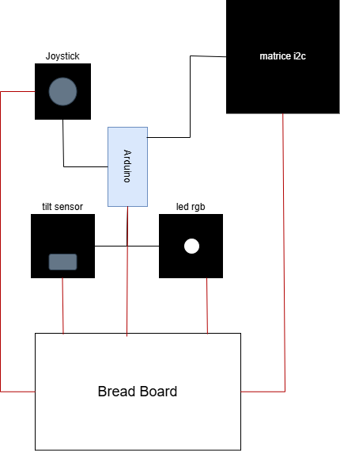

le but de notre petit jeu consiste a créer une clé/pattern sur la matrice i2c en utilisant le potentiomètre. 
plus tu est proche de la bonne led a allumer, plus la lumière de la led brille forte.

une fois le clé crée au complet, tu doit commencer a débarrer une porte avec(figurativement). commence a balancer le tilt sensor vers la droite et la gauche jusqu'a temps que tu entende un click, répète jusqu'a avoir débarer la porte et voila!

liste des composants:
-matrice i2c
-digital tilt sensor
-joystick
-led rgb
-arduino nano ESP-32
-bread board

répartition des tâches:
Laurent:
-création du README
-code les fonctions

Arris:
-conception du circuit
-code le joystick

diagram: 

Attribution des broches:
i2c = scl:A5 sda:a4
joystick = x:A6 y:A7 btn:D2
LED rgb = r:A1 g:A2 b:A3
tilt sensor = D6